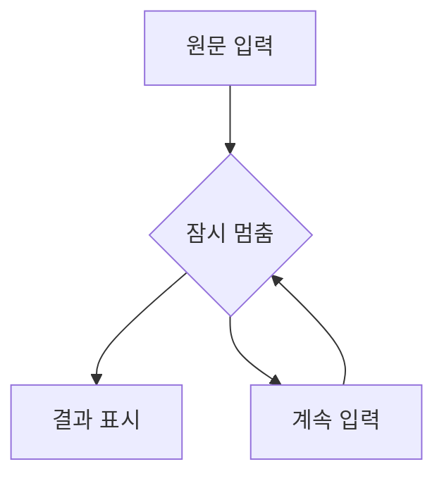
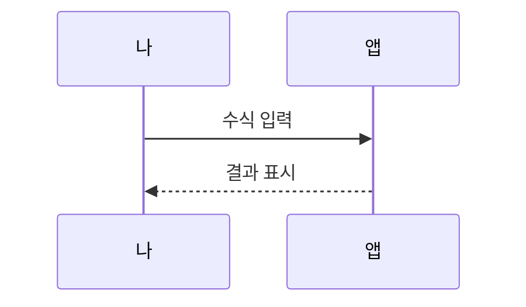

# 수식과 다이어그램

수식과 다이어그램은 입력하는 동안 원문이 보이고, 잠시 쉬면 결과로 바뀝니다.

## 인라인 수식

이차방정식의 근은 $x = \frac{-b \pm \sqrt{b^2 - 4ac}}{2a}$ 로 구합니다.

## 블록 수식

$$
\sum_{i=1}^{n} i = \frac{n(n+1)}{2}
$$

## 순서도

## 순서 그림

